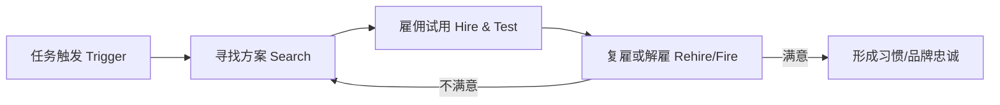

# Ch1：JTBD 核心理论

## 1.1 什么是"任务"

> **定义**：一项任务是指个人在**特定背景下**想要实现的**进展**。
> — 克里斯坦森《与运气竞争》

**三个关键要素**：
| 要素 | 说明 | 奶昔案例对应 |
|------|------|--------------|
| **进展** | 用户想从现状 A 移动到更好状态 B | 早高峰：从"无聊/饿" → "有事做/不饿/准时到公司" |
| **背景** | 触发任务的时空情境 | 早高峰独自开车 40 分钟 vs 傍晚带孩子吃饭 |
| **阻力** | 阻碍进展的障碍(焦虑/习惯/成本/无方案) | 早餐太难吃/太麻烦/吃完还饿/手忙脚乱 |

---

## 1.2 JTBD 四步闭环（用户决策全程）

| 阶段 | 用户心理 | 企业切入点 |
|------|----------|------------|
| **触发** | "我卡住了/我想进步" | 发现未被满足的任务、设计触发点营销 |
| **寻找** | "有什么能帮我？" | 让方案在任务关键词下被搜到(SEO/渠道/口碑) |
| **雇佣** | "试一下这个" | 降低试用门槛、首次体验必须完美完成任务 |
| **评估** | "好用/不好用" | 持续对齐任务、消除解雇理由、设计复雇钩子 |

---

## 1.3 三维任务分类（别只做功能性）

| 维度 | 定义 | 奶昔案例 | 提问模板 |
|------|------|----------|----------|
| **功能性任务** | 要完成的具体事务 | 早高峰：填饱肚子、打发时间、单手操作 | "用户要在什么情境下完成什么具体事？" |
| **情感性任务** | 想获得的感受/避免的感受 | 早高峰：不焦虑/有掌控感/不内疚(健康) | "用户希望感觉如何？害怕感觉如何？" |
| **社交性任务** | 想给他人留下的印象 | 傍晚：好爸爸形象/不想当说"不"的坏人 | "用户希望别人怎么看他？" |

> **实战铁律**：只做功能性 = 陷入参数竞赛；三维打通 = 建立护城河。

---

## 1.4 奶昔案例全解（书中核心、必背）

### 早高峰任务（6 点-9 点）
- **背景**：独自开车通勤 40 分钟，无聊、饿、一只手握方向盘
- **雇佣奶昔**：浓稠→喝久(20 分钟)→填饱肚子→杯架放得下→单手吸管
- **竞争对手**：香蕉(吃太快)、甜甜圈(掉渣/两手)、贝果(抹酱麻烦)、咖啡(喝完还饿)
- **关键洞察**：**不是早餐食品在竞争，是"打发无聊通勤"的任务在竞争**

### 傍晚任务（15 点-18 点）
- **背景**：父亲带孩子、想补偿白天说"不"的愧疚、寻找说"是"的低成本时机
- **雇佣奶昔**：分量小→吃得快→不内疚→亲子互动媒介
- **竞争对手**：玩具店逛逛、玩接球游戏、看动画片
- **关键洞察**：**同一人、同产品、不同时空 = 完全不同的任务 = 完全不同的竞品集**

---

## 1.5 本章可执行清单

- [ ] 能否用"帮用户在 [情境] 完成 [进展]"一句话描述你的产品价值？
- [ ] 列出用户当前雇佣的**所有**替代方案(含笨办法/Excel/实习生/不作为)
- [ ] 区分功能/情感/社交三维任务，哪维最强？哪维被忽略？
- [ ] 找 3-5 个典型用户，分早/晚两个情境跑访谈(见 Ch4)
