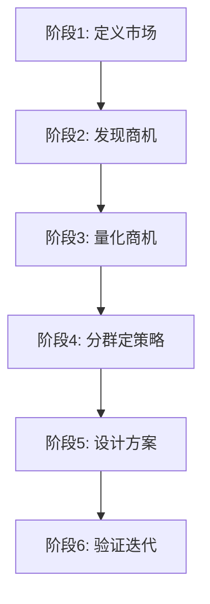

# Ch3：ODI 实践框架

> ODI = 把 JTBD 理论变成**可量化、可重复、可预测**的创新流程。Tony Ulwick (Strategyn) 20 年实战沉淀。

---

## 3.1 ODI 六阶段全景



| 阶段 | 目标 | 核心产出 | 关键动作 | 耗时参考 |
|------|------|----------|----------|----------|
| **1 定义市场** | 用任务而非产品定义市场 | 任务陈述 + 任务执行者/购买决策者/生命周期支持者三类客户 | 访谈 10-15 人 → 写任务陈述 | 1-2 周 |
| **2 发现商机** | 识别所有期望结果 | 50-150 条 Outcome 陈述 | Job Map 8 步 × 每步 5-15 个 Outcome | 2-3 周 |
| **3 量化商机** | 算出哪个缺口最大 | 商机分排序表、重要性/满意度矩阵 | 量化问卷 100-300 样本、算法跑分 | 2-4 周 |
| **4 分群定策略** | 找到细分增长点 | Outcome-based Segments + 策略矩阵定位 | 统计聚类 → 打标签 → 选策略 | 1-2 周 |
| **5 设计方案** | 针对 Top 缺口设概念 | 概念原型、价值主张、商业模式草图 | 设计冲刺、原型测试 | 3-6 周 |
| **6 验证迭代** | 用市场验证假设 | MVP、定价测试、上市计划 | 小范围试点、收集真实数据 | 持续 |

---

## 3.2 商机算法（核心数学——必会算）

```python
# 核心公式
Opportunity Score = Importance + (Importance - Satisfaction)
# 等价于：2 × Importance - Satisfaction

# 解读
# Importance(重要性) 1-10：用户多在乎这个结果
# Satisfaction(满意度) 1-10：现有方案多好用
# Score 10-20：极大缺口(必攻)
# Score 5-10：中等缺口(优化)
# Score <5：无缺口/过度服务(暂缓或砍掉)
```

### 实战速算表

| 重要性 | 满意度 | 商机分 | 标签 | 动作 |
|--------|--------|--------|------|------|
| 9 | 2 | **16** | 🔴 极大缺口 | MVP 必做、资源倾斜 |
| 8 | 4 | **12** | 🔴 大缺口 | 核心功能、差异化切入 |
| 7 | 6 | **8** | 🟡 中缺口 | 迭代优化、体验打磨 |
| 6 | 6 | **6** | 🟡 小缺口 | 后续迭代、低成本试错 |
| 5 | 8 | **2** | 🟢 过度服务 | 砍功能、省资源 |
| 9 | 9 | **9** | 🟢 已满足 | 维持、不投新资源 |

> **避坑**：不要只看 Importance 高就做——Importance 9 + Satisfaction 8 = Score 10(看似高实则边际)，不如 Importance 7 + Satisfaction 3 = Score 11。

---

## 3.3 成果导向分群

**传统分群**：人口统计/画像/行为 → 无法解释"为什么买"
**ODI 分群**：按**期望结果(Outcome)满意度模式**聚类 → 同一群人对同一组结果有相似的重要性/满意度画像

### 分群四步法

```bash
# 1. 把所有 Outcome 的重要性/满意度做成用户×指标矩阵
# 2. K-means/层次聚类 → 3-8 个簇
# 3. 每簇看：哪些 Outcome 重要且不满意？ → 这是该簇的核心商机
# 4. 给每簇起名(基于任务情境，非人口统计) → 选策略矩阵定位
```

### 策略矩阵（JTBD Growth Strategy Matrix）

| 策略类型 | 适用段位 | 核心打法 | 典型案例 |
|----------|----------|----------|----------|
| **差异化** | 核心任务满意度低、重要性高 | 在核心 Outcome 上做到极致 | Dyson 吸尘器/特斯拉 |
| **主导型** | 核心任务已满足、但边缘任务有缺口 | 做全任务套件、一站式 | Microsoft Office/Adobe CC |
| **颠覆型** | 非核心用户被主流方案排除(太贵/太复杂) | 低端/新市场切入、极简完成核心任务 | Uber/Netflix/早期 PC |
| **离散型** | 任务极其小众/专用 | 专用工具、高价高利润 | 专业医疗设备/EDA 软件 |
| **维持型** | 成熟市场、缺口全小 | 成本控制、运营效率 | 成熟消费品/公用事业 |

---

## 3.4 本章可执行清单

- [ ] 写出你的**任务陈述**："帮 [执行者] 在 [情境] 完成 [进展]"
- [ ] 用 Ch2 Job Map 拆解出 50+ 条 Outcome 陈述(格式：动词+宾语+语境，如"快速确认会议纪要的准确性")
- [ ] 设计量化问卷(Importance/Satisfaction 1-10)，发 100+ 目标用户
- [ ] 跑商机算法，取 Top 10 缺口 → 这是产品路线图的前 3 个版本
- [ ] 做 Outcome-based Segmentation，看看有没有被忽视的细分群
- [ ] 在策略矩阵上定位你的产品 → 决定差异化/颠覆/维持策略
