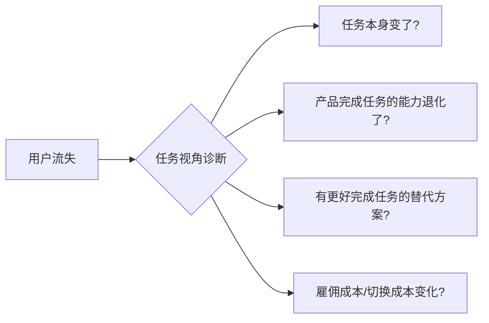

# Ch5：JTBD 三大战略级应用场景

> 书中第 4 章核心——JTBD 不是工具箱，是**战略透镜**。三个场景覆盖企业成长全周期。

---

## 5.1 场景一：突破产品创新瓶颈

### 现状诊断
- 团队陷入"更好、更快、更便宜"的功能军备竞赛
- 每版迭代边际收益递减，用户不买账
- 竞品同质化，差异化只剩价格战

### JTBD 破局路径

| 传统路径 | JTBD 路径 |
|----------|-----------|
| 问用户要什么功能 → 堆功能 | 挖用户核心任务 → **重新定义价值边界** |
| 对标竞品参数 → 超越参数 | **以任务为中心重新划定竞争集** |
| 资源向"功能优化"倾斜 | 资源向"任务完成度"倾斜 |

### 实战三步走

```bash
# 步骤 1：写任务陈述（而非产品陈述）
# ❌ "我们要做最好的会议纪要工具"
# ✅ "帮产品经理在会后 10 分钟产出可执行、可追溯、可分享的纪要"

# 步骤 2：画任务地图 + 算商机分（见 Ch2/Ch3）
# 找出 Top 3 缺口 → 这是创新切入点

# 步骤 3：用"任务语言"重写价值主张
# ❌ "AI 摘要、自动提取待办、多格式导出"
# ✅ "帮 PM 摆脱'回忆补笔记'的焦虑，把会议变成可执行的行动清单"
```

### 案例：录音笔 → 会议智能助手
- **旧任务定义**："录音清晰、存储大、操作简单" → 竞品：索尼/奥林巴斯/手机录音
- **JTBD 重定义**："帮职场人在会后快速拿到关键结论和待办" → 竞品：**飞书妙记/Notion AI/实习生/自己硬听/不听**
- **结果**：录音笔厂商若只做录音参数，必死；转型做"会后智能整理"才有生路。

---

## 5.2 场景二：诊断用户流失根源

### 现状诊断
- 数据能告诉"谁走了、何时走、走前干了什么"
- **数据不能告诉"为什么走"**
- 常规挽留：推送优惠/加功能/改UI → 治标不治本

### JTBD 诊断框架



| 流失类型 | 任务视角解释 | 对策 |
|----------|--------------|------|
| **任务演进** | 用户进步了，原任务不再存在/升级了 | 跟随任务演进、延伸新任务(如: 从"记账"→"理财规划") |
| **价值错位** | 产品功能加了，但核心任务完成度没变/退步 | 砍边缘功能、回归核心任务、重新对齐 |
| **跨界截胡** | 新玩家用新方式更好完成同一任务 | 重新定义竞争集、主动自颠覆 |
| **雇佣阻力** | 学习成本/迁移成本/信任成本过高 | 降低试用门槛、提供迁移工具、担保承诺 |

### 实战诊断清单（流失用户访谈 5 人）

- [ ] 你当初雇佣我们是要完成什么任务？
- [ ] 那个任务现在还存在吗？有没有变化？
- [ ] 现在你用什么完成这个任务？为什么换了？
- [ ] 我们哪里没做好，让你觉得"不值得再雇佣"？
- [ ] 什么条件满足你会回来？

---

## 5.3 场景三：应对跨界竞争

### 核心洞察
> **最危险的竞争对手，不在你的行业分类里。**
> — 克里斯坦森

| 传统竞争视角 | JTBD 竞争视角 |
|--------------|---------------|
| 同行业/同品类/同渠道 | **完成同一任务的所有方式** |
| 参数对比 | 任务完成度对比 |
| 护城河 = 技术/品牌/渠道 | 护城河 = **任务完成度的持续领先** |

### 跨界威胁扫描表（每季度跑一次）

| 核心任务 | 当前主流方案 | 潜在跨界威胁 | 威胁信号 | 应对预案 |
|----------|--------------|--------------|----------|----------|
| 会后快速产出纪要 | 专用纪要工具/手工整理 | **会议平台自带 AI(Zoom/腾讯会议/飞书)** | 平台发布纪要功能/用户反馈"不用额外工具了" | 集成平台 API/做平台做不到的深度/转型做平台插件 |
| 通勤打发时间 | 短视频/播客/音乐/游戏 | **自动驾驶/车载大模型/AR 导航** | 车企发布车载娱乐生态/用户时长转移 | 提前布局车载场景/做内容而非渠道 |
| 团队协作对齐 | 飞书/钉钉/Notion/Slack | **AI Agent 自动协调/数字孪生组织** | Agent 产品融资/大厂内测 | 拥抱 Agent 协议/提供结构化数据接口 |

### 预判跨界的三个追问（每月战略会必问）

1. **用户雇佣我们完成什么任务？** —— 持续校准任务陈述
2. **还有哪些方式能完成这个任务？** —— 发散竞争集(含笨办法/人工/不作为)
3. **有没有新技术/新模式能以 10 倍性价比完成这个任务？** —— 扫描技术趋势映射到任务

---

## 5.4 本章可执行清单

- [ ] 季度战略会：跑一次"跨界威胁扫描表"
- [ ] 流失用户访谈：按 5.2 清单跑 5 人，产出流失诊断报告
- [ ] 产品规划会：用任务语言重写所有 Epic 的价值主张
- [ ] 年度规划：在策略矩阵(Ch3)上定位每条产品线，决定资源分配
