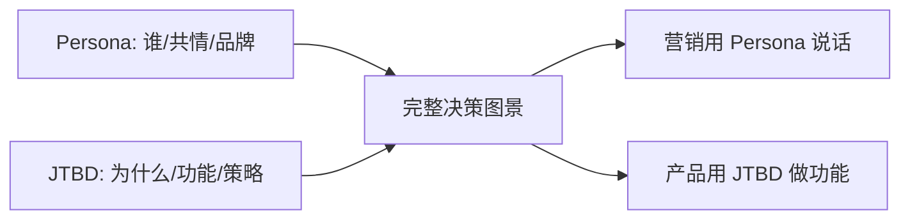

# Ch6：JTBD 落地常见误区（血泪版）

> 知乎/人人都是产品经理/硅谷独角兽学院/Runwise 等实战社区高频翻车案例复盘。

---

## 6.1 六大误区对照表

| # | 误区 | 典型表现 | 后果 | 纠正动作 |
|---|------|----------|------|----------|
| **1** | **把功能当任务** | "用户任务是导出 PDF" | 做出导出 PDF 功能，用户不用(真任务是"快速分享给老板看") | 追问 3 个"为什么"直到触及进展 |
| **2** | **用画像替代任务** | "25 岁、一线、白领、喜欢效率" | 同画像用户在不同时刻雇佣完全不同的产品 | 画像+任务双轨：画像解释"谁"，任务解释"为什么现在" |
| **3** | **只做功能性任务** | 忽略情感/社交维度 | 产品好用但用户不复购、不推荐、无品牌溢价 | 每任务必填三维画像卡(见 Ch1) |
| **4** | **竞品定义太窄** | 只盯同品类 | 被跨界颠覆(录音笔输给会议软件、出租车输给 Uber) | 季度跑"跨界威胁扫描表"(见 Ch5) |
| **5** | **访谈问偏** | 问"想要什么功能/会不会买" | 收到虚高需求、假阳性功能清单 | 死磕 4.2 脚本：场景→触发→进展→替代→评估→标准→情绪 |
| **6** | **一锤子买卖** | 跑完一轮访谈/问卷就不动了 | 任务演进、市场变化、竞品迭代全盲区 | 建立持续 JTBD 雷达：月度微访谈+季度全量扫描 |

---

## 6.2 JTBD vs Persona：不是非此即彼

| 维度 | Persona(用户画像) | JTBD(任务理论) |
|------|-------------------|----------------|
| **回答的问题** | "这个人大概是谁？" | "这个人现在到底想完成什么？" |
| **稳定性** | 相对稳定(人口统计/心理特质) | **随情境剧烈变化**(同一人早/晚两任务) |
| **指导决策** | 营销文案/渠道选择/品牌调性 | **产品功能/路线图/定价/竞争策略** |
| **颗粒度** | 群体级 | **个体×情境级** |
| **局限** | 无法解释"为什么此刻行动" | 无法提供同理心细节/共情细节 |

### **黄金组合用法**（书中/海尔/硅谷学院共识）

> **口诀**：营销讲人设，产品讲任务。别让 Persona 写 PRD，别让 JTBD 写文案。

---

## 6.3 落地自检清单（每冲刺/每版本必跑）

### 产品层
- [ ] 每个 Epic 能否用"帮 [谁] 在 [情境] 完成 [进展]"一句话讲清？
- [ ] 路线图 Top 3 是否对应商机算法 Top 3 缺口？
- [ ] 有没有只做功能性任务、忽略情感/社交的功能？
- [ ] 竞品分析是否包含"笨办法/人工/不作为/跨界替代品"？

### 研发层
- [ ] 验收标准是否包含"任务完成度指标"(而非仅功能通过)？
- [ ] 有没有"为功能而功能"的代码(无 JTBD 假设支撑)？
- [ ] 技术债偿还是否优先偿还"阻碍核心任务完成"的债？

### 运营/市场层
- [ ] 文案/落地页是否用任务语言(而非功能语言)？
- [ ] 获客渠道是否覆盖"任务触发时刻"的搜索词/场景？
- [ ] 用户分群是否基于 Outcome 满意度模式(而非仅人口统计)？

### 战略层
- [ ] 季度是否跑过"跨界威胁扫描表"？
- [ ] 流失诊断是否用过任务视角框架？
- [ ] 年度资源分配是否在策略矩阵上有依据？

---

## 6.4 实战红绿灯（快速判断项目健康度）

| 信号 | 🟢 健康 | 🟡 预警 | 🟔 危险 |
|------|---------|---------|---------|
| **新人能否在 1 分钟内说出产品核心任务** | 能 | 卡顿 | 说不出/说成功能 |
| **路线图前 3 项对应商机分 Top 3** | 是 | 部分 | 完全不符 |
| **最近 1 个月跑过用户访谈** | 是 | 只有数据无访谈 | 0 访谈 |
| **能说出 3 个跨界威胁及应对** | 能 | 只说同行 | 0 威胁/无应对 |
| **流失用户最近有过任务视角访谈** | 有 | 只有问卷/数据 | 0 诊断 |

---

## 6.5 本章可执行清单

- [ ] 对着 6.1 表逐项自查，标出团队当前中了几条
- [ ] 补齐 6.3 自检清单缺项，下个冲刺前闭环
- [ ] 把 6.4 红绿灯做成看板贴在显眼处，每周站会过一遍
- [ ] 组织一次"JTBD vs Persona"内部分享，统一认知
